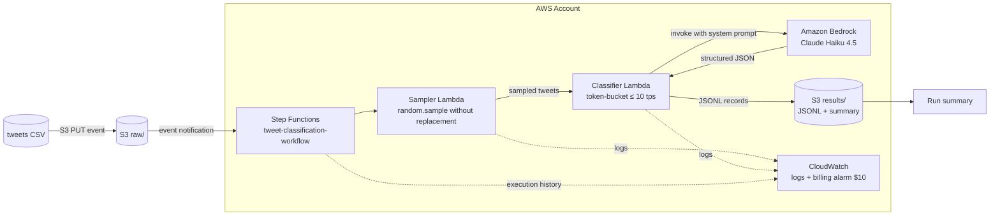

# tweet-llm-pipeline-design

Fall 2026 — Architecture & Design

- Author: Nihal G
- Status: Complete

---

## 1. Problem / Objective

Build a **real-time suicide-classification pipeline** that:

1. Reads a static file of tweets as though tweets were **arriving in real time**.
2. Selects a **random sample without replacement** (at least 100 tweets).
3. Classifies each tweet via an **LLM on AWS Bedrock** into one of four levels of suicide likelihood.
4. Emits two derived columns per tweet: `suicide_likelihood` (4 classes) and `alert_of_risk` (binary).
5. Respects a hard processing-rate ceiling of **10 tweets per second**.
6. Runs entirely on event-driven AWS services, is cost-conscious (target &lt; $50 total), and can accept an 11-tweet CSV with blank labels without modification.

## 2. Input Dataset

| Property | Value |
|---|---|
| File | `Suicide_Ideation_Dataset(Twitter-based).csv` |
| Location | `data/` (byte-identical copy of the provided file) |
| Records | 1,787 tweets |
| Columns | `Tweet` (text), `Suicide` (label) |
| Encoding | UTF-8, no BOM, LF line endings |
| Label values | `Not Suicide post` (1,127) · `Potential Suicide post` (660) |

Important observations that shape the design:

- The label column contains **only two classes** — there is **no confirmed `Suicide post` (high-risk) class** in the training data.
- The four-level `suicide_likelihood` target therefore cannot be mapped 1:1 from existing labels; the LLM rubric must derive all four levels from language patterns, with the `[Suicide]` column usable only for **offline validation**, never at inference.
- The raw file must remain **byte-identical**. `.gitattributes` disables line-ending conversion for `data/**`, and the pipeline never modifies the input file.

## 3. Required Outputs

Per analyzed tweet, the pipeline writes a result record (JSON Lines) containing at minimum:

| Column | Values | Derivation |
|---|---|---|
| `suicide_likelihood` | `high risk` · `potentially likely` · `neutral` · `unlikely` | LLM classification via rubric |
| `alert_of_risk` | `1` · `0` | `1` if `suicide_likelihood ∈ {high risk, potentially likely}`; `0` if `∈ {neutral, unlikely}` |

Result record schema:

```json
{
  "tweet_id": 1234,
  "tweet": "<original text, unchanged>",
  "suicide_likelihood": "potentially likely",
  "alert_of_risk": 1,
  "confidence": 0.82,
  "rationale": "short reason",
  "model": "anthropic.claude-haiku-4-5-20251001-v1:0",
  "classified_at_utc": "2026-08-08T12:00:00Z"
}
```

Error record (model output still invalid after the corrective retry — see Section 15):

```json
{
  "tweet_id": 1234,
  "error": "invalid_model_output",
  "model": "anthropic.claude-haiku-4-5-20251001-v1:0",
  "classified_at_utc": "2026-08-08T12:00:00Z"
}
```

An error record carries **no** `suicide_likelihood` field. The classification enum is strictly the four required values (`high risk`, `potentially likely`, `neutral`, `unlikely`) — a fifth "unclear"-style value is never produced.

## 4. Requirements → Design Responses

| # | Requirement | Design response |
|---|---|---|
| 1 | Produce real-time classification pipeline | Event-driven Step Functions workflow, triggered by an S3 upload event; sampling + classification happen as tweets "arrive" from the file |
| 2 | `suicide_likelihood` with exactly 4 values | Enforced by prompt contract + a post-hoc enum validator in the classifier (invalid values rejected/retried) |
| 3 | `alert_of_risk` = 1 for high risk / potentially likely, else 0 | Derived deterministically in code from `suicide_likelihood` — never left to the model (single source of truth) |
| 4 | May not use `[Suicide]` column at inference | Column is never sent to the model; used only in an optional offline validation report |
| 5 | Real-time simulation, ≤ 10 tweets/sec | Token-bucket rate limiter inside the classifier (Section 7) |
| 6 | Random sampling without replacement, ≥ 100 tweets | `random.sample(tweets, n)` — no replacement; configurable `n` (default 120) |
| 7 | Prompt must contain system instructions | Full system prompt with an explicit evaluation rubric (Section 9 / Appendix A) |
| 8 | Python + Bedrock + event-driven + storage | Python 3.13; Bedrock Claude Haiku 4.5; Step Functions + Lambda; S3 |
| 9 | Repo structure: README visible, `config`/`.env` gitignored, `src/` | See Section 14 |
| 10 | File content unchanged, storage format free | Raw CSV stored byte-identical in S3; results as separate JSONL (never written back into the source) |
| 11 | No API keys exposed | `.env` in `.gitignore`; no secrets in code; IAM role-based credentials in Lambda |
| 12 | Small CSV (11 tweets, blank target) | Pipeline is file-agnostic; blank target is handled as "absent" (Section 13) |
| 13 | Cost < $50 (less than half of the $100 credits) | ~0.01¢ per tweet-classification with Haiku 4.5 (Section 12); CloudWatch billing alarm at $10 |

## 5. Architecture Overview

```
                    +--------------------------------------------------------------+
                    |                    AWS Account                                |
                    |                                                              |
  tweets CSV  -->   |  S3 (raw)  --PUT event-->  Step Functions state machine      |
  (or sample        |                            |                                 |
   CSV)             |                            v                                 |
                    |                     +------------+                           |
                    |                     |  Sampler   |  random.sample()          |
                    |                     |  Lambda    |  without replacement      |
                    |                     +------------+                           |
                    |                            |  sampled tweets                 |
                    |                            v                                 |
                    |                     +------------+     +--------------+      |
                    |                     | Classifier |---->|  Amazon      |      |
                    |                     | Lambda     |     |  Bedrock     |      |
                    |                     | token-     |     |  Claude       |      |
                    |                     | bucket     |     |  Haiku 4.5    |      |
                    |                     | limiter    |<----|              |      |
                    |                     +------------+     +--------------+      |
                    |                            |  JSONL results                  |
                    |                            v                                 |
                    |                     S3 (results)  +  summary report          |
                    |                                                              |
                    |   CloudWatch: logs, metrics, billing alarm ($10)             |
                    +--------------------------------------------------------------+
```

## 6. Data Flow

1. **Ingest** — The operator uploads the CSV to `s3://<bucket>/raw/`. The object key is versioned; the file content is stored byte-identical.
2. **Trigger** — The S3 PUT event starts the Step Functions state machine (event-driven requirement).
3. **Sample** — The **Sampler Lambda** reads the CSV (UTF-8), validates the schema, and draws `n` tweets with `random.sample(..., k=n)` — **random, without replacement**. `n` defaults to 120 (≥ 100 required) and never exceeds the number of rows available (so the 11-tweet sample file processes all 11).
4. **Classify** — The **Classifier Lambda** walks the sampled tweets in order. For each tweet it acquires a token from a token-bucket limiter, calls Bedrock (Claude Haiku 4.5) with the system prompt + tweet, validates the JSON against the enum contract, derives `alert_of_risk` in code, and appends the result record.
5. **Store** — Results are written to `s3://<bucket>/results/<run_id>.jsonl` plus a short run summary (counts per class, alert rate). The input file is never modified.
6. **Observe** — Every step logs to CloudWatch; a billing alarm (threshold $10) protects the credit budget.

## 7. Real-Time Processing & Rate Limiting (≤ 10 tweets/sec)

### Requirement

Tweets must appear to be processed in real time at a maximum of **10 tweets per second**. A known pitfall is that naive rate-limiting approaches "easily produce errors."

### Design: token bucket

The classifier uses a **token bucket**:

- **Default (strict) configuration:** refill rate `R = 10` tokens/second, capacity `C = 1` token.
- With `C = 1`, at most one token can ever be available, so each classification must wait for the next refill: requests are paced exactly ~1/10 sec apart. No burst is possible, and **no one-second window can contain more than 10 request starts** — the "maximum rate of 10/sec" requirement is guaranteed.
- A tweet may be classified only when ≥ 1 token is available; each classification consumes 1 token.
- The limiter computes availability from **timestamps** (`time.monotonic()`), never from a blind `sleep()` per tweet:
  - `wait = (tokens_needed - tokens_available) / refill_rate` — the precise delay until the next token exists.
  - The delay is derived from wall-clock time, so pacing is drift-free across a full run — this is a token-bucket/rate-pacing algorithm (the kind of rate-limit design that is easy to get wrong), not a fixed per-tweet sleep.
- **Configurable:** `R` and `C` come from the environment/config (SSM Parameter Store), so the max rate can be modified without code changes. The strict default is `C = 1`; raising `C` would allow bursts of up to `C` consecutive starts, trading away the strict one-second ceiling — so the default stays at `C = 1`.

### Why this approach (and not the error-prone ones)

| Approach | Failure mode | Our choice |
|---|---|---|
| Fixed `sleep(0.1)` before every call | LLM latency varies; sleep + actual latency creates *measured* rates &lt; 10 tps, but overlapping/async paths can exceed the ceiling; also wastes wall-clock time if tokens are already available | time-based token bucket — precise, no drift |
| Simple counter + sleep in a loop | Drifts over long runs; bursts when counter resets | refill is continuous, not reset-based |
| Global per-account throttles / queue pumping | Under-counts or over-counts because concurrency is invisible | limiter is per-execution state, single writer thread per invocation |
| No limiter at all | Rate = model latency × concurrency, easily exceeding 10 tps | n/a |

### Optional extension: configurable rate

`R` and `C` come from the environment/config (SSM Parameter Store), so the max rate/second can be changed without code edits. This satisfies the extra-credit "modify the rate" feature; the strict default (`C = 1`, `R = 10`) remains the guaranteed 10/sec ceiling.

## 8. Sampling: Random Without Replacement

- `random.sample(population, k)` guarantees distinct indices — **no tweet is selected twice** within a run.
- A `SAMPLE_SIZE` config (default 120) satisfies "analyze at least 100 tweets."
- `SAMPLE_SIZE = min(config, len(rows))` — the 11-tweet sample file therefore processes all 11.
- Optional `RANDOM_SEED` for reproducible debugging runs; default is non-deterministic (true randomness).

## 9. LLM Classification (AWS Bedrock)

- **Model:** Claude Haiku 4.5, model ID `anthropic.claude-haiku-4-5-20251001-v1:0` (US cross-region inference profile `us.anthropic.claude-haiku-4-5-20251001-v1:0`).
- **Why Haiku 4.5:** the workload is short-text classification with structured JSON output — not complex reasoning. Haiku 4.5 is the current low-cost, high-throughput tier: fast enough to pace at 10 tps and cheap enough that even thousands of calls stay far below the $50 budget.
- **Structured output contract:** the system prompt requires a strict JSON response `{"suicide_likelihood", "alert_of_risk", "confidence", "rationale"}`. The classifier parses and validates it; on schema violation it retries once with the original tweet and the raw model output included as a corrective hint.
- **Inference hygiene:** the `[Suicide]` label is never included in the prompt. The tweet text itself is the only input.
- **Safety note:** the prompt states the output is an automated, non-medical screening signal, which keeps the LLM in an analytical-rubric mode and reduces hedging behavior.

### Rubric (system prompt, draft)

| Level | What the model should look for |
|---|---|
| `high risk` | Explicit, present-tense suicidal intent: stated plans, method/means, timing, active ideation, goodbye/apology framing ("I've written my note", "this is the last thing I'll post") |
| `potentially likely` | Personal suicidal ideation expressed with hedge or ambiguity: "I don't want to be here anymore", "wish I could disappear", hopelessness, self-harm references that implicate the author |
| `neutral` | Suicidal topic discussed **impersonally**: news, research, art, song lyrics, support posts, general statements ("depression is a serious illness") — no first-person risk |
| `unlikely` | No indication of suicidal content; ordinary social chatter; ambiguous but benign content |

Full prompt text: **Appendix A**.

## 10. Handling of the Existing `[Suicide]` Column

- **Training/validation only.** The design allows the column to be used offline to sanity-check the LLM (e.g., a `validate` CLI flag produces a confusion-style comparison of `suicide_likelihood ∈ {high risk, potentially likely}` against `Suicide == "Potential Suicide post"`).
- **Never at inference.** The column is dropped from the row before the Bedrock prompt is constructed; the runtime classification path does not read it.
- Because the dataset lacks a confirmed high-risk class, this comparison is approximate by design and is reported as such.

## 11. AWS Services

| Service | Role |
|---|---|
| **Amazon S3** | Storage: raw input (`raw/`), results JSONL + run summary (`results/`). Input content byte-identical. |
| **S3 event notification / EventBridge** | Event-driven trigger on PUT to `raw/` → starts the workflow. |
| **AWS Step Functions** | Orchestrates Sampler → Classifier; retry/catch policies; gives a visible execution graph for demo and review. |
| **AWS Lambda** | Sampler Lambda (CSV read, sampling) and Classifier Lambda (rate limiting + Bedrock calls). Python 3.13 runtime. |
| **Amazon Bedrock** | LLM inference, Claude Haiku 4.5. The AWS account must have model access enabled for the model ID. |
| **Amazon CloudWatch** | Logs (all steps), metrics, and a billing alarm at $10. |
| **AWS IAM** | Least-privilege roles: Lambda roles scoped to the specific S3 bucket + Bedrock invoke + logging; no long-lived keys in code. |
| **SSM Parameter Store** | (config) rate limits, sample size, model ID — no secrets, keeps tuning out of code. |
| **AWS Secrets Manager** | (if any secret credentials are ever needed, e.g. for the git-backed config alternative) — primary design keeps secrets out of the account entirely. |

## 12. Cost Considerations

Estimate (Haiku 4.5, input ~$1/M tokens, output ~$5/M tokens — **provisional: re-verify against current AWS Bedrock pricing**):

| Item | Value |
|---|---|
| Tokens per tweet (input ~30, output ~80) | ~110 |
| Run of 120 tweets | ~13K tokens total |
| Estimated LLM cost per run | ≈ $0.01–0.05 |
| Other services (S3, Lambda, SFN, CW) | cents |
| Small-file run (11 tweets) | ≈ $0.001 |
| **Projected total** | **well under $50 budget** |

Controls: CloudWatch **billing alarm at $10**; `MAX_TWEETS` cap in config; no retry storms (bounded retries); nothing scheduled/looping when idle (event-driven = pay-per-event).

All figures above are **provisional estimates** and should be re-verified against current AWS Bedrock pricing. The budget target is $50; this design stays well under it even at 10× the projected estimate.

## 13. Small-File / Blank-Label Compatibility

- The repository includes `data/sample_tweets.csv` — 11 tweets with a blank `Suicide` target — to exercise the pipeline on a small input.
- The pipeline is **file-agnostic**: any CSV with a `Tweet` column is accepted. A blank/absent `Suicide` column is treated as "no label provided" and is simply never used (consistent with Section 10).
- A new CSV is dropped into `data/` (or uploaded to `raw/`) and the same command/workflow runs untouched — **no code changes required**.
- A **local mock/dry-run mode** exercises the same code paths without calling Bedrock, so the pipeline can be run without an AWS account.

## 14. Repository Structure

```
README.md                       # project overview
LICENSE                         # MIT
.gitignore                      # .env, config/.env, caches, secrets
.gitattributes                  # data/** -text (byte preservation)
.github/workflows/tests.yml     # CI: pytest on push
docs/
  tweet-llm-pipeline-design.md  # this document
src/
  pipeline/                     # core Python package
  aws/                          # Lambda handlers, state machine, deploy script
config/
  .env.example                  # keys/values documented, real .env gitignored
data/
  sample_tweets.csv             # 11-tweet sample fixture (blank labels)
tests/                          # pytest suite
```

`.gitignore` keeps `config/.env` and other secrets out of version control, and `.gitattributes` preserves the sample CSV bytes.

## 15. Error Handling

| Failure | Handling |
|---|---|
| Bedrock `ThrottlingException` / 429 | Exponential backoff + jitter, bounded retries (max 3) — throttle-free by design thanks to the token bucket |
| Malformed / non-JSON model output | One corrective retry; if still invalid → write an **error record** (`error: "invalid_model_output"`, `suicide_likelihood` **absent** — never a fifth classification value) and continue (pipeline never halts on one tweet) |
| Missing `Tweet` column / empty file | Ingest validation in Sampler; clear error message; state machine marks the run failed before any spend |
| Blank `Suicide` column (sample file) | Accepted; label simply unused |
| S3 read/write errors | SDK retries + Step Functions retry on the state; DLQ for poisoned events |
| Billing risk | CloudWatch alarm at $10 + hard `MAX_TWEETS` cap |

## 16. Architecture Diagram (Mermaid)



## 17. Optional Extensions

1. **Configurable rate** — rate/sec and capacity via SSM Parameter Store (already designed in Section 7).
2. **Observability** — CloudWatch dashboard: executions, per-class counts, token-bucket wait time, LLM latency, error rate.
3. **Vector database ETL** — DynamoDB (or vector store) fed by an ETL Lambda triggered on upload; enables similarity retrieval of past high-risk tweets.
4. **Other services** — AWS Comprehend sentiment as a cheap pre-filter; documented comparison of value vs. cost. Traditional ML (SageMaker) confusion-matrix comparison against the LLM.

## 18. Delivery

| Phase | Content |
|---|---|
| Design | Architecture, rate-limiter proof, error contracts, cost model |
| Implementation | Pipeline code, tests, AWS Lambda + Step Functions deployment |
| Verification | Live run on AWS, pacing check, error-free classification |
| Documentation | README, implementation walkthrough, challenges log |

## 19. Assumptions

- [x] Default `SAMPLE_SIZE` is 120 (≥ 100 required).
- [x] Bedrock model access for `anthropic.claude-haiku-4-5-20251001-v1:0` was approved.
- [ ] Re-verify current Haiku 4.5 pricing before relying on the cost table.

---

## Appendix A — System Prompt (draft)

```
You are an automated, non-medical screening classifier for social-media text.
You analyze one tweet and return ONLY a JSON object — no prose, no markdown.

Classification levels for "suicide_likelihood":
- "high risk":       explicit, present-tense suicidal intent — stated plans,
                     method/means, timing, active ideation, goodbye/apology framing.
- "potentially likely": personal suicidal ideation with hedge or ambiguity —
                     "I don't want to be here anymore", hopelessness,
                     self-harm references that implicate the author.
- "neutral":         the suicide topic discussed impersonally — news, research,
                     art, lyrics, support posts, general statements.
- "unlikely":        no indication of suicidal content; ordinary chatter.

Rules:
1. Focus on the author's own state, not the topic of the tweet.
2. If in doubt between "neutral" and "unlikely", choose "unlikely".
3. Only use "high risk" for explicit intent; ambiguity belongs in
   "potentially likely".
4. "alert_of_risk" is 1 if suicide_likelihood is "high risk" or
   "potentially likely"; otherwise 0.
5. Do not diagnose. If content is clearly non-linguistic (links, media only),
   classify as "unlikely".

Return exactly:
{"suicide_likelihood": "<level>", "alert_of_risk": 0|1,
 "confidence": <0.0-1.0>, "rationale": "<one sentence>"}
```

---

*End of design document.*
